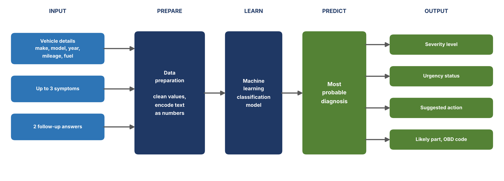
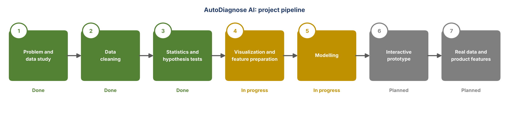
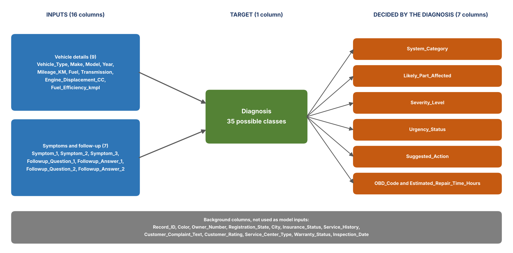
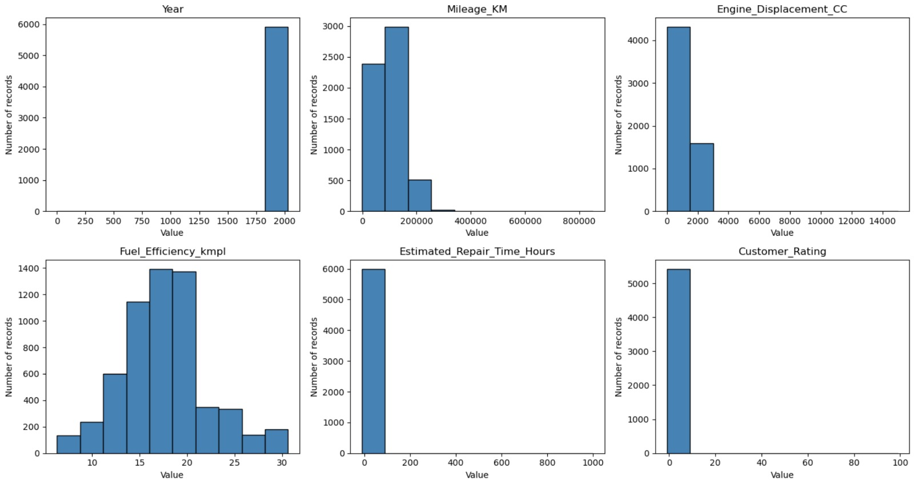
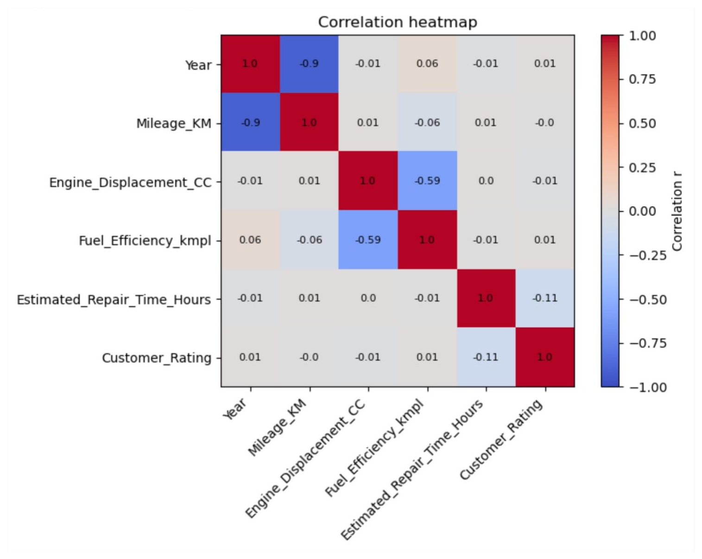
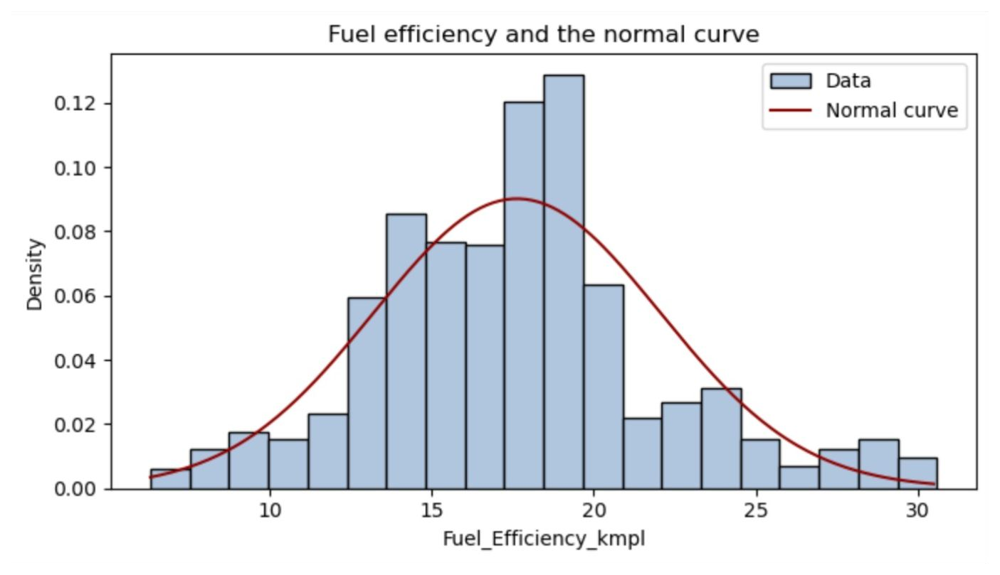
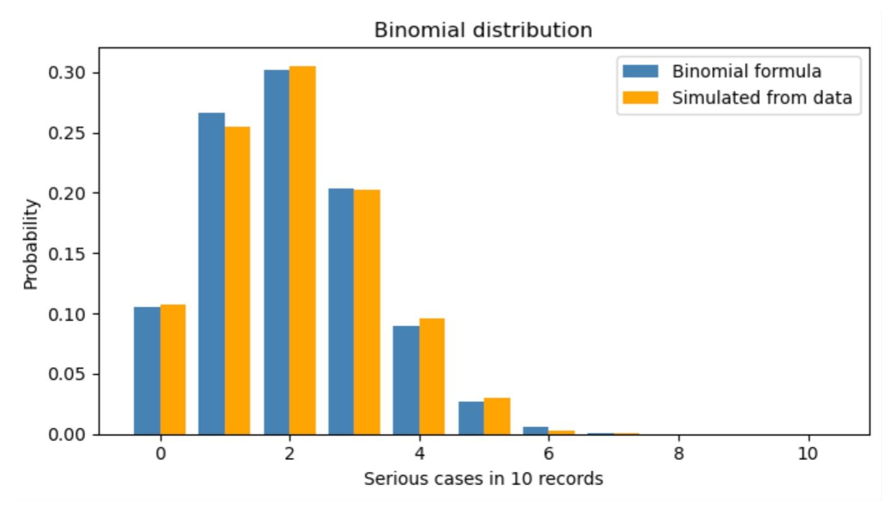
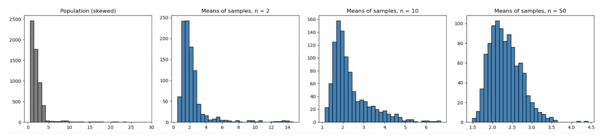

<div align="center">

# 🚗 AutoDiagnose AI
### A Multi-Symptom Vehicle Diagnostic System built with Machine Learning

*Tell the system what your car is doing. Get the most probable fault, how serious it is, how urgent it is, and what to do next.*


</div>

---

## 📑 Contents

1. [The Problem](#-the-problem)
2. [The Solution](#-the-solution)
3. [How It Is Meant to Work](#-how-it-is-meant-to-work)
4. [Project Stage and Roadmap](#%EF%B8%8F-project-stage-and-roadmap)
5. [Data](#-data)
6. [Analysis Notebooks](#-analysis-notebooks)
7. [Results So Far](#-results-so-far)
8. [Key Design Decisions](#-key-design-decisions)
9. [Tech Stack](#%EF%B8%8F-tech-stack)
10. [Getting Started](#-getting-started)
11. [Limitations and Responsible Use](#%EF%B8%8F-limitations-and-responsible-use)
12. [Origin and Author](#-origin-and-author)

---

## 🔧 The Problem

When a warning light comes on or the car starts making an unusual noise, most owners cannot tell what is wrong. They depend completely on the mechanic, and they cannot judge whether the suggested repair is reasonable or how urgent it is.

Existing symptom-checking tools usually follow a **one-symptom-to-one-cause** rule. Real faults do not work like that: one fault can show several overlapping symptoms, and one symptom can come from several faults. A good diagnosis needs several symptoms **and** a few follow-up questions.

## 💡 The Solution

**AutoDiagnose AI** is a machine learning-based, multi-symptom diagnostic system for cars. From basic vehicle details, up to three reported symptoms and two follow-up answers, it is designed to give:

| Output | Meaning |
|---|---|
| **Most probable diagnosis** | The fault the data points to (35 diagnosis classes) |
| **Severity level** | How serious the fault is |
| **Urgency status** | How soon the car should be seen to |
| **Recommended action** | What the owner should do next |
| **Likely part and OBD code** | Where to look, for the mechanic conversation |

The goal is to help an owner arrive at the service centre **informed**, not to replace the mechanic.

## 🧭 How It Is Meant to Work



*The arrows show the direction of the data, from left to right. Severity, urgency, suggested action and likely part are fixed by the diagnosis, so they are looked up once the diagnosis is known.*

Illustrative example of the intended input and output format:

> **Input:** Maruti Suzuki, petrol, manual · Symptom 1: *Car won't start* · Follow-up: answered by the owner
> **Output:** most probable diagnosis (for example *faulty alternator or loose belt*), with its severity, urgency and suggested action

*(Format illustration only. Real predictions and accuracy will be reported in this repository once the models are evaluated.)*

## 🗺️ Project Stage and Roadmap

This repository is currently at the **data analysis and modeling** stage. Nothing below is claimed as finished until it appears in the repository.




- [x] **Phase 1: Problem definition and dataset study** — scope, columns, data quality issues identified
- [x] **Phase 2: Data preparation** — duplicates, text, types, impossible values, missing values and dates cleaned
- [x] **Phase 3: Statistical analysis** — probability, distributions, correlation, hypothesis tests, ANOVA (regression is planned)
- [ ] **Phase 4: Modeling** — compare Logistic Regression, Decision Tree, Random Forest, k-NN and others; pick the best
- [ ] **Phase 5: Interactive prototype** — a simple web interface that asks symptoms and follow-up questions and shows the result
- [ ] **Phase 6: Real data and wider coverage** — train on real service-centre records; extend to motorcycles, trucks and electric vehicles
- [ ] **Phase 7: Product features** — repair cost estimate, nearby service centres, maintenance reminders, live sensor (OBD) input

## 📊 Data

| Property | Value |
|---|---|
| Files | `vehicle_diagnostic_dataset.csv` (raw) and `vehicle_diagnostic_cleaned.csv` (after data cleaning: 5,911 rows, no missing values) |
| Size | 6,000 rows × 36 columns |
| Type | Structured, labelled, static CSV |
| Source | **Synthetic**, generated by a program, because real service-centre records are private |
| Target | `Diagnosis` (35 classes) |



**Column groups**

| Group | Columns | Role |
|---|---|---|
| Vehicle details | `Vehicle_Type`, `Make`, `Model`, `Year`, `Mileage_KM`, `Fuel`, `Transmission`, `Engine_Displacement_CC`, `Fuel_Efficiency_kmpl` | Inputs |
| Symptoms and follow-up | `Symptom_1`–`Symptom_3`, `Followup_Question_1/2`, `Followup_Answer_1/2` | Inputs |
| Target | `Diagnosis` | Predicted |
| Fixed by the diagnosis | `System_Category`, `Likely_Part_Affected`, `OBD_Code`, `Severity_Level`, `Urgency_Status`, `Suggested_Action` | Shown after prediction, **not** used as inputs |
| Range output | `Estimated_Repair_Time_Hours` | Shown as a usual range |
| Record and background | `Record_ID`, `Color`, `Owner_Number`, `Registration_State`, `City`, `Service_Center_Type`, `Warranty_Status`, `Insurance_Status`, `Service_History`, `Customer_Rating`, `Inspection_Date`, `Customer_Complaint_Text` | Context |

**Raw data quality (deliberately realistic):** 89 duplicate rows, missing values in 19 columns, impossible values (for example `Year` from 0 to 2032, negative mileage), mixed spellings (`Diesel`, `DIESEL`, `petrol`, `cng`), numbers stored as text, and several date formats. Cleaning this is a real step of the pipeline, not an afterthought.

## 🧪 Analysis Notebooks

Each notebook is one stage of the pipeline and says what it contributes to the product.

| No. | Stage | What it does | Why it matters for the product | Notebook | Status |
|---|---|---|---|---|---|
| 01 | Raw data exploration | Summary statistics, histograms, scatter plots on the raw data | Shows what is in the data and what is wrong with it | `01_Raw_Data_Exploration.ipynb` | ✅ Added |
| 02 | Data cleaning | Duplicates, text, data types, impossible values, outliers, imputation, dates | A model trained on wrong values learns wrong rules | `02_Data_Cleaning.ipynb` | ✅ Added |
| 03 | Probability and distributions | Probability, Bayes, random variables, Binomial, Poisson, Normal | Shows how likely serious faults are and which systems cause them | `03_Probability_and_Distributions.ipynb` | ✅ Added |
| 04 | Moments, correlation and CLT | Moments, joint distributions, covariance, correlation, central limit theorem | Shows how columns relate to each other | `04_Moments_Correlation_CLT.ipynb` | ✅ Added |
| 05 | Hypothesis testing and ANOVA | Confidence intervals, Z, t, F, chi-square tests, one-way and two-way ANOVA | Checks which differences and relationships are real | `05_Hypothesis_Testing_and_ANOVA.ipynb` | ✅ Added |
| 06 | Data catalog, SQL and features | Column catalog, SQL database, wrangling, scaling, encoding, new features | Prepares clean, model-ready data and a queryable database | `06_Data_Wrangling_and_SQL.ipynb` | ⏳ Planned |
| 07 | Visualization | Bar charts, line graphs, pie chart, heatmaps, box plots | Makes patterns and class imbalance visible | `07_Visualization.ipynb` | ⏳ Planned |
| 08 | Regression | Simple linear regression between variables | Measures relationships such as vehicle age and mileage | – | ⏳ Planned |
| 09 | Clustering | Groups similar records | Finds natural groups of vehicles and faults | – | ⏳ Planned |
| 10 | Classification | Random Forest and other classifiers | The core diagnosis model | – | ⏳ Planned |
| 11 | Association rules | Frequent symptom combinations | Helps decide which follow-up questions to ask | – | ⏳ Planned |

The full written report (theory, outputs and observations) is in `FODS_Project_Report.docx` (also as PDF).

## 📈 Results So Far

All results below come from the notebooks in this repository and are calculated on the **synthetic** dataset.

**The raw data was not usable as it was.** Impossible values (Year = 0, a repair time of 999 hours, a rating of 99) squeeze most graphs into a single bar. After cleaning, the data went from 6,000 rows and 13,485 missing cells to 5,911 clean rows with no missing cells.



**Vehicle age and mileage are strongly linked, and larger engines use more fuel.**



**Fuel efficiency is roughly normal, with a longer right side.** The extra high-efficiency records come mostly from CNG vehicles.



**The number of serious cases in a batch of 10 records follows the Binomial distribution** (probability of a serious case = 0.2015).



**Averages of repeated samples become bell-shaped (central limit theorem),** even though repair time itself is very skewed.



### Key findings

- About **1 in 5 cases is serious** (High or Critical). Critical cases are only 2.7% of all cases and appear only in the engine system.
- **Severity depends on the system affected** (chi-square p < 0.0001) and **not on the fuel type** (p = 0.225).
- **Fuel type is the main factor for fuel efficiency:** CNG about 23.8 kmpl, Diesel about 17.7 and Petrol about 16.1. Manual vehicles are slightly more efficient than automatic ones.
- **Repair time rises with severity:** about 17 hours for Critical cases against about 1.2 hours for Low cases.
- Vehicle age and mileage are strongly related (r = -0.903) and engine size lowers fuel efficiency (r = -0.588).

---

## 🧱 Key Design Decisions

- **No data leakage.** Six columns (`System_Category`, `Likely_Part_Affected`, `OBD_Code`, `Severity_Level`, `Urgency_Status`, `Suggested_Action`) are fully decided by the diagnosis. They are outputs, never inputs. Using them as inputs gives a perfect but meaningless score.
- **Inputs are only what a car owner can actually give:** vehicle details, symptoms and follow-up answers. Columns known only after the service (such as `Customer_Rating`) are not used in the first model.
- **Class imbalance is handled on purpose.** The 35 diagnoses are not equally common (raw file: smallest 46 records, largest 227), so models are judged class by class, not by accuracy alone.
- **Explainability matters.** An owner should understand why a diagnosis was suggested, which favours models that can explain themselves.
- **Basic statistics are written from their formulas** (mean, median, mode, standard deviation, quartiles) and checked against pandas. Libraries are used for plots and complex methods.

## 🛠️ Tech Stack

- **Used now:** Python 3, pandas, numpy, matplotlib, scipy, Jupyter (JupyterLab or Jupyter Notebook, started through Anaconda Navigator)
- **Planned for modelling:** scikit-learn
- **Planned for the prototype:** a lightweight web interface and an API layer to serve the trained model

## 🚀 Getting Started

### Requirements

| Requirement | Details |
|---|---|
| Python | Version 3.8 or higher |
| Environment | **Anaconda** with **JupyterLab** or **Jupyter Notebook**, opened through **Anaconda Navigator** (it already includes most of the libraries below) |
| Libraries | pandas, numpy, matplotlib, scipy (listed in `requirements.txt`) |
| Data files | `vehicle_diagnostic_dataset.csv` in the same folder as the notebooks |

### Run the project

1. Install [Anaconda](https://www.anaconda.com/download) and open **Anaconda Navigator**.
2. Click **Launch** under **JupyterLab** (or **Notebook**).
3. Download or clone this repository and open its folder inside Jupyter.
4. If a library is missing, run `pip install -r requirements.txt` in the Anaconda Prompt or in a notebook cell.
5. Run the notebooks **in this order**, using **Kernel → Restart & Run All** in each:
   1. `01_Raw_Data_Exploration.ipynb`
   2. `02_Data_Cleaning.ipynb` (creates `vehicle_diagnostic_cleaned.csv`)
   3. `03_Probability_and_Distributions.ipynb`
   4. `04_Moments_Correlation_CLT.ipynb`
   5. `05_Hypothesis_Testing_and_ANOVA.ipynb`

Notebooks 03 onwards use the cleaned file, so notebook 02 must be run before them.

```bash
git clone https://github.com/yatharthjoshi08/autodiagnose-ai.git
cd autodiagnose-ai
```

```
.
├── README.md
├── requirements.txt
├── FODS_Project_Report.docx                  # full report: theory, outputs, observations
├── FODS_Project_Report.pdf                   # same report as PDF
├── vehicle_diagnostic_dataset.csv            # raw dataset
├── vehicle_diagnostic_cleaned.csv            # created by 02_Data_Cleaning
├── 01_Raw_Data_Exploration.ipynb
├── 02_Data_Cleaning.ipynb
├── 03_Probability_and_Distributions.ipynb
├── 04_Moments_Correlation_CLT.ipynb
├── 05_Hypothesis_Testing_and_ANOVA.ipynb
├── images/                                   # diagrams and result graphs used in this README
└── figures/                                  # graphs saved by the notebooks (optional)
```

---

## ⚠️ Limitations and Responsible Use

- The data is **synthetic**. Results show that the method works, but they are **not** proof of accuracy on real vehicles.
- The output is a **preliminary guide**. It does not replace a qualified mechanic, and safety-critical symptoms (brakes, steering, overheating) should always be checked in person.
- Scope is currently **passenger cars only**.
- The system does not estimate repair cost or service charges.

## 👤 Origin and Author

This project started as a coursework project for **Fundamentals of Data Science** at the University of Petroleum and Energy Studies (UPES), and is structured so that it can grow into a real product.

**Yatharth Joshi**  
B.Tech. Computer Science and Engineering (Data Science), Semester 3, UPES  
GitHub: [yatharthjoshi08](https://github.com/yatharthjoshi08)

---

<div align="center">

Built by **Yatharth Joshi**

</div>
